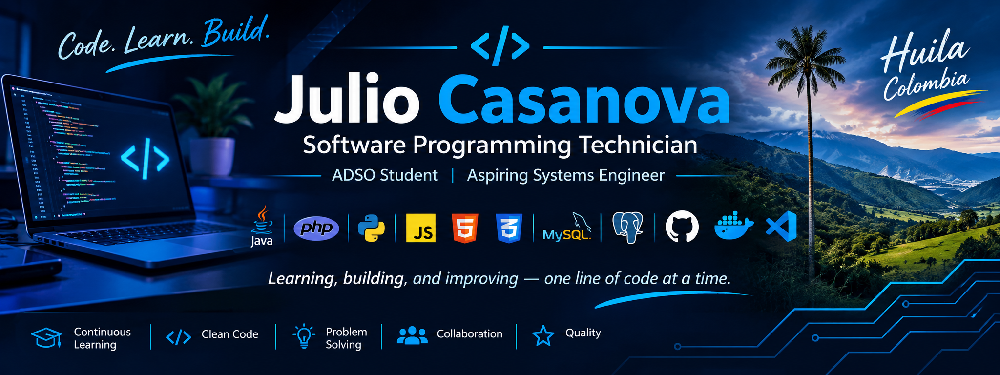

 <!-- GitHub Profile README -->
<!--
  Julio Casanova - GitHub Profile README
  Repository: JulioCasanova01
-->

  <!-- Replace with your custom banner -->
  

  # Hi, I'm Julio Casanova

  ### Software Programming Technician | ADSO Student | Aspiring Systems Engineer

  **Building solutions through code, continuous learning, and software engineering.**

  

    
    
    
  

  [GitHub](https://github.com/JulioCasanova01)

---

## About Me

I'm a **Software Programming Technician** and an **Analysis and Development of Software (ADSO) student at SENA**, based in Huila, Colombia.

I'm passionate about technology, software development, problem-solving, and building practical solutions that address real-world needs.

My technical background includes programming, relational databases, web development, version control, and software engineering fundamentals.

I'm continuously improving my skills through academic projects, independent learning, and hands-on experience.

My long-term goal is to become a **Systems Engineer**, strengthening my knowledge of software architecture, backend development, databases, and scalable software solutions.

- Currently studying: Analysis and Development of Software (ADSO) – SENA.
- Technical qualification: Software Programming Technician.
- Course in pedagogical leadership.
- Main interests: Backend Development, Web Development, Databases, and Software Architecture.
- Currently exploring: GitHub Foundations, cloud computing, and software development best practices.
- Based in: Huila, Colombia.

---

## Technical Skills

### Programming Languages & Web Technologies

  
  
  
  
  
  
  

### Databases

  
  
  

- Relational database design and modeling.
- SQL queries and data manipulation.
- Database administration fundamentals.
- Relationships, constraints, and normalization.

### Development Tools & Technologies

  
  
  
  
  
  
  
  
  

Development environments and operating systems:

- Windows 11.
- Linux Mint.
- Apache and local development environments.
- Git Bash and command-line tools.
- Docker containers for database environments.

### Software Engineering & Architecture

- Model-View-Controller (MVC).
- Three-tier architecture.
- Separation of concerns.
- Relational database modeling.
- CRUD operations.
- Algorithm design and problem-solving.
- Software documentation.
- Software quality fundamentals.
- ISO 9001 fundamentals.
- Version control and collaborative development.
- Agile project management fundamentals.

---

## Featured Projects

### 1. HuilaTour – Conecta

**Intelligent Regional Tourism Management System**

A software project focused on promoting and managing tourism information across the department of Huila, Colombia.

The platform aims to connect tourists, visitors, administrators, and tourism service providers through a centralized digital solution.

**Main features:**
- Tourism destination and attraction management.
- Tourism service provider management.
- Search and filtering by categories.
- Destination information, photographs, and prices.
- Maps and geographic location.
- Road conditions and climate information.
- WhatsApp contact integration.
- User roles and access control.
- Tourism information management.

**Technology Stack:**

- Backend: Java.
- Database: PostgreSQL.
- Frontend: HTML, CSS, JavaScript.
- Architecture: Three-tier architecture + MVC.
- Security concepts: JWT and Role-Based Access Control (RBAC).

---

### 2. PHP Web Development Projects

Academic and practical projects focused on server-side development using PHP and relational databases.

**Topics explored:**
- CRUD applications.
- Form handling and validation.
- PHP functions and parameters.
- Indexed and associative arrays.
- Multidimensional arrays.
- Database connectivity.
- User and information management.
- Session and authentication fundamentals.

**Technology Stack:** PHP, MySQL, HTML, CSS.

---

### 3. Database Development & Management

Practical exercises and projects involving relational database design and management.

**Topics explored:**
- Database creation and configuration.
- Relational modeling.
- SQL queries.
- Table relationships.
- Primary and foreign keys.
- Data integrity.
- MySQL and MariaDB environments.
- PostgreSQL fundamentals.

**Tools:** MySQL Workbench, Docker, Laragon, XAMPP.

---

### 4. Programming Fundamentals & Algorithms

Programming exercises focused on developing logical thinking and problem-solving skills.

**Topics explored:**
- Algorithms and pseudocode.
- Conditional statements.
- Loops and iterations.
- Functions and modular programming.
- Arrays and matrices.
- Basic data processing.
- Java and Python programming fundamentals.

---

### 5. Git & GitHub Practice

Practical work focused on version control and collaborative software development.

**Topics explored:**
- Repository management.
- Commits and branches.
- Pull requests.
- Merge and conflict resolution.
- Markdown documentation.
- Collaborative workflows.
- GitHub Issues and project management.

---

## Currently Learning & Exploring

I'm committed to continuous learning and strengthening my technical profile.

| Area | Learning Path |
|---|---|
| Version Control | GitHub Foundations (GH-900) |
| Cloud Computing | AWS fundamentals |
| Software Development | Backend and application architecture |
| Databases | Advanced SQL and database management |
| Software Engineering | Design principles and software quality |
| Agile Methodologies | Scrum fundamentals |
| Professional Development | Systems Engineering |

*These are learning interests and development goals, not a list of certifications already obtained.*

---

## Software Development Principles

I believe that good software development goes beyond writing code.

The principles I aim to apply in my projects include:

- **Clean Code:** Writing readable and maintainable code.
- **Problem Solving:** Understanding requirements before implementing solutions.
- **Documentation:** Keeping projects understandable and organized.
- **Collaboration:** Working effectively through version control and shared repositories.
- **Continuous Learning:** Improving technical knowledge through practice.
- **Quality:** Developing solutions with reliability and maintainability in mind.

## Let's Connect!

I'm open to connecting with other developers, learning from the community, collaborating on projects, and exploring new opportunities in software development.

  

    

  **"Learning, building, and improving — one line of code at a time."**

  © 2026 Julio Casanova | Software Development & Continuous Learning

